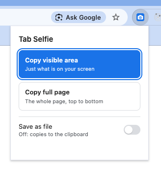

# Tab Selfie

A Chrome extension that takes a screenshot of the current tab, either the visible area or the full page, and copies it to your clipboard or saves it as a PNG.

## Install

Tab Selfie isn't on the Chrome Web Store, so you load it yourself:

1. Download or clone this folder to your computer.
2. In Chrome, go to `chrome://extensions`.
3. Turn on **Developer mode** (top right).
4. Click **Load unpacked** and select the `tab-selfie` folder (the one with `manifest.json` in it).
5. Click the puzzle icon in the toolbar and pin **Tab Selfie** so it's easy to reach.

<!-- Screenshot: chrome://extensions with Developer mode and Load unpacked highlighted -->

### Updating

After you change the code or pull a new version, go to `chrome://extensions` and click the reload icon on the Tab Selfie card.

## Use

1. Open the page you want to capture.
2. Click the Tab Selfie icon, or press **Alt+Shift+S** (**Option+Shift+S** on a Mac).
3. Choose one:
   - **Copy visible area** (default, so you can just press Enter): what you can see on screen right now.
   - **Copy full page**: the whole page, top to bottom.
4. Paste it wherever you need it (Cmd+V / Ctrl+V).

### Save as a file instead

Switch on **Save as file** to save a PNG instead of copying it. Files are saved to `Downloads/tab-selfie/` and named after the site and the time, for example `example.com_2026-10-19_14-05-32.png`. Chrome remembers this setting.

### Change the shortcut

Go to `chrome://extensions/shortcuts` and set a different key for Tab Selfie.

## Good to know

- **Yellow "debugging" bar:** a full page capture briefly shows a bar saying Tab Selfie started debugging the browser. This is normal: Chrome needs that access to render the whole page in one go. The bar goes away once the screenshot is taken.
- **DevTools open:** full page capture won't work while DevTools is open on that tab. Close it and try again.
- **Pages you can't capture:** Chrome blocks screenshots of `chrome://` pages, other extension pages and the Chrome Web Store.
- **Very long pages:** big images get shrunk when pasted into chats, so small text can be hard to read. For detail, use the visible area.

## Permissions

| Permission | Why |
| --- | --- |
| `activeTab` | Capture the tab you're on, only when you click the icon |
| `debugger` | Render the full page for a full page screenshot |
| `clipboardWrite` | Copy the image to your clipboard |
| `downloads` | Save the PNG when **Save as file** is on |
| `storage` | Remember your **Save as file** setting |

Nothing is sent anywhere: screenshots stay on your computer.

## Development

See [docs/DEVELOPMENT.md](docs/DEVELOPMENT.md) for running the tests and how CI works.
